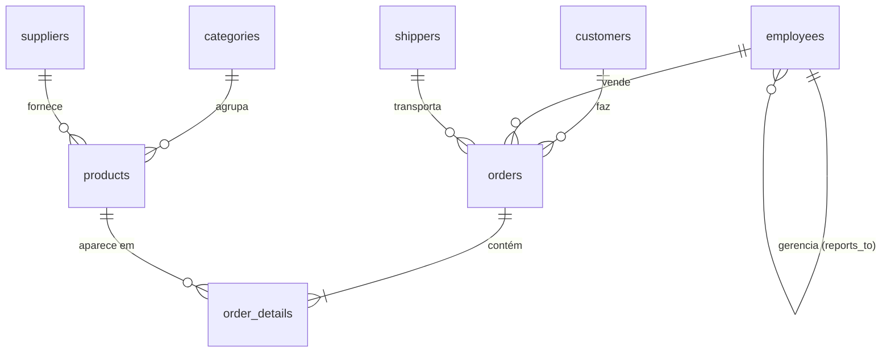
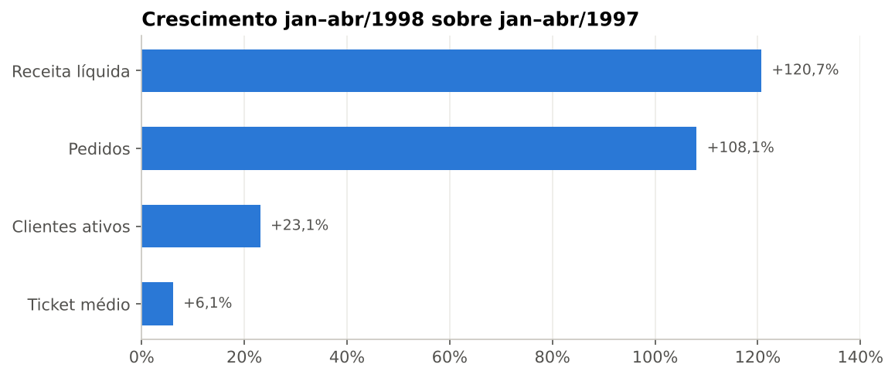
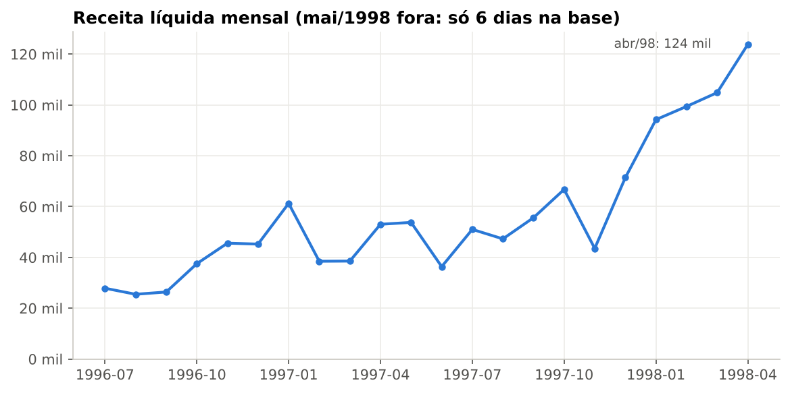
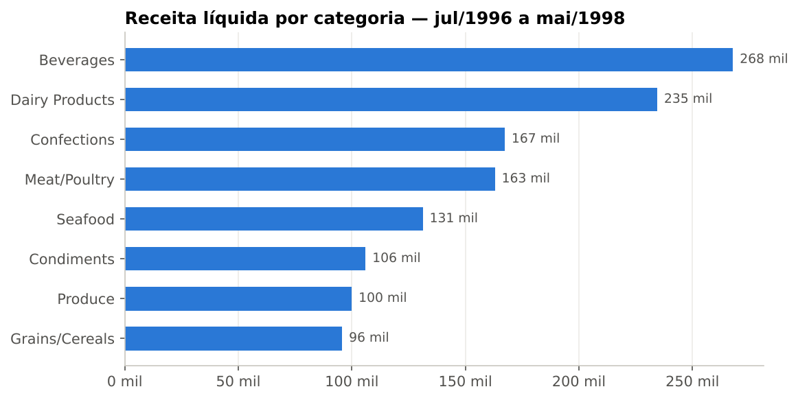
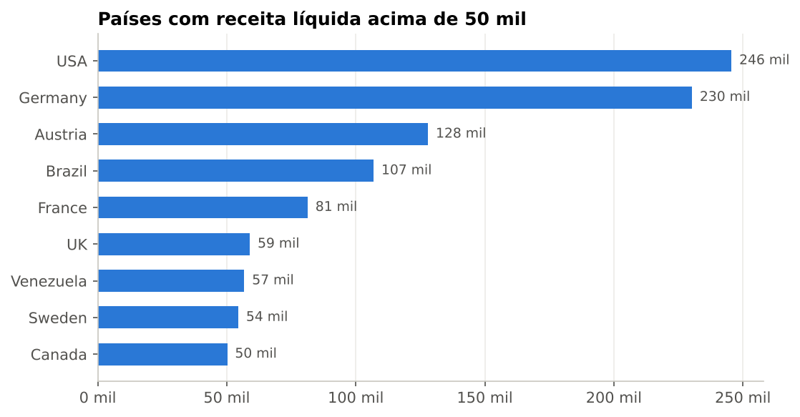
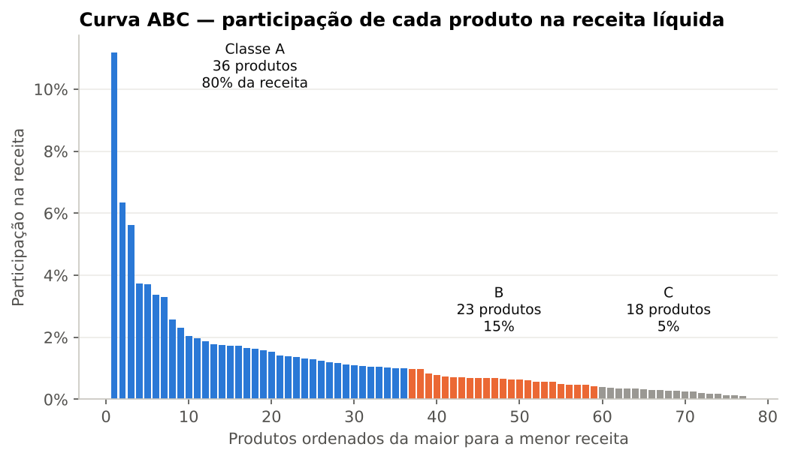
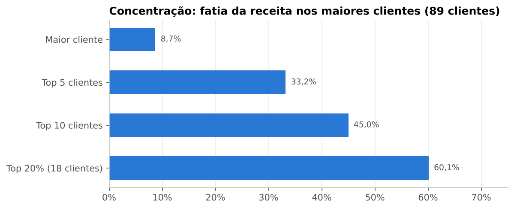
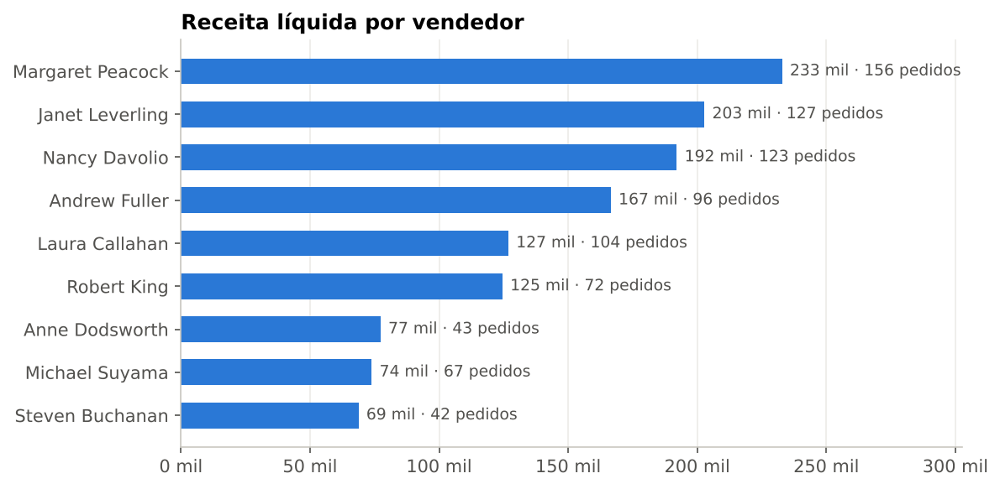

# Consultas SQL para Análise de Dados

Desenvolvimento de consultas SQL para **extração, integração e análise de dados**, aplicadas a uma
base de vendas de uma distribuidora de alimentos (Northwind). O projeto parte de consultas simples e
chega a indicadores de negócio, sempre respondendo **o que aconteceu e por que isso importa para a gestão**.

### Principais atividades

- Criação de consultas com **SELECT, WHERE e ORDER BY** → [`sql/01_consultas_basicas.sql`](sql/01_consultas_basicas.sql)
- Integração de tabelas utilizando **JOIN** (INNER, LEFT e SELF JOIN) → [`sql/02_joins.sql`](sql/02_joins.sql)
- Agrupamentos e agregações com **GROUP BY** e funções agregadas (SUM, COUNT, AVG, MIN, MAX, HAVING) → [`sql/03_agregacoes.sql`](sql/03_agregacoes.sql)
- Criação de consultas para **geração de indicadores** (CTEs e funções de janela) → [`sql/04_indicadores.sql`](sql/04_indicadores.sql)
- **Perguntas de negócio** com visão de gestor → [`sql/05_perguntas_negocio.sql`](sql/05_perguntas_negocio.sql)

### Tecnologias

**SQL** (SQLite) · Python (apenas para criar o banco, executar as consultas e gerar os gráficos) · GitHub

**GitHub:** [github.com/leandroanalytics/sql-analytics](https://github.com/leandroanalytics/sql-analytics)

---

## Sumário

1. [Resumo executivo](#1-resumo-executivo)
2. [Base de dados](#2-base-de-dados)
3. [Estrutura do repositório](#3-estrutura-do-repositório)
4. [Como executar](#4-como-executar)
5. [Catálogo de consultas](#5-catálogo-de-consultas)
6. [Indicadores (KPIs)](#6-indicadores-kpis)
7. [Perguntas de negócio e respostas](#7-perguntas-de-negócio-e-respostas)
8. [O que a base responde e o que não responde](#8-o-que-a-base-responde-e-o-que-não-responde)
9. [Recomendações para a gestão](#9-recomendações-para-a-gestão)
10. [Decisões técnicas e cuidados](#10-decisões-técnicas-e-cuidados)

---

## 1. Resumo executivo

Período analisado: **04/07/1996 a 06/05/1998** · valores na moeda da base (dólar americano).

| Indicador | Valor | Consulta |
|---|---:|:---:|
| Receita líquida (após descontos, sem frete) | **US$ 1.265.793,04** | Q18 |
| Pedidos | **830** | Q18 |
| Clientes que compraram | **89** de 91 cadastrados | Q18 · Q09 |
| Ticket médio por pedido | **US$ 1.525,05** | Q18 |
| Descontos concedidos | US$ 88.665,55 (**6,5%** da receita bruta) | Q18 |
| Pedidos enviados no prazo | **95,4%** (37 atrasados de 809 enviados) | Q19 |
| Crescimento jan–abr/1998 x jan–abr/1997 | **+120,7%** na receita | Q20 |

**Os 5 achados que um gestor precisa saber**

1. **O negócio está acelerando — e o motor é volume.** Comparando o mesmo período (jan–abr), a receita
   cresceu 120,7%, puxada pelo número de pedidos (+108,1%); o ticket médio subiu só 6,1%. Abril/1998 foi o
   melhor mês da série (US$ 123,8 mil).
2. **Um produto vale 11% da empresa.** O vinho *Côte de Blaye* sozinho gera 11,2% da receita, e seu
   fornecedor (*Aux joyeux ecclésiastiques*) responde por 12,1% — com apenas 2 produtos.
3. **Receita que não vai se repetir.** 16,9% da receita veio de produtos hoje **descontinuados**. Em
   Carnes/Aves (*Meat/Poultry*) a dependência é de **86,4%**: sem substitutos, essa categoria tende a encolher.
4. **Concentração moderada em clientes.** Os 10 maiores clientes fazem 45,0% da receita; os 3 primeiros
   (QUICK-Stop, Ernst Handel e Save-a-lot) passam de US$ 100 mil cada.
5. **16 clientes estão há mais de 90 dias sem comprar**, incluindo *Mère Paillarde* (US$ 28,9 mil
   históricos, 188 dias parado) — lista pronta para a equipe comercial priorizar.

---

## 2. Base de dados

**Northwind** — base pública e clássica de vendas de uma distribuidora de alimentos especiais, com
clientes em 21 países. Fonte usada: [pthom/northwind_psql](https://github.com/pthom/northwind_psql),
convertida para SQLite e CSV neste projeto (removidas apenas colunas sem uso analítico, como fotos e fax).



| Tabela | Linhas | O que representa |
|---|---:|---|
| `orders` | 830 | Cabeçalho do pedido: cliente, vendedor, datas (pedido, prometida, envio), frete |
| `order_details` | 2.155 | Itens do pedido: produto, preço praticado, quantidade e desconto |
| `products` | 77 | Catálogo: preço de tabela, estoque, ponto de reposição, se é descontinuado |
| `customers` | 91 | Clientes (empresas) e país |
| `employees` | 9 | Equipe comercial e hierarquia (`reports_to`) |
| `suppliers` | 29 | Fornecedores |
| `categories` | 8 | Categorias de produto |
| `shippers` | 6 | Transportadoras (3 delas nunca usadas — ver Q10) |

O modelo completo, com chaves primárias e estrangeiras, está em
[`sql/00_criacao_tabelas.sql`](sql/00_criacao_tabelas.sql). A carga confere a integridade referencial
(`PRAGMA foreign_key_check`) ao final.

---

## 3. Estrutura do repositório

```
sql-analytics/
├── README.md
├── requirements.txt
├── data/                          # 8 tabelas em CSV (fonte da verdade)
├── database/
│   └── northwind.db               # banco SQLite pronto para uso
├── sql/
│   ├── 00_criacao_tabelas.sql     # modelo: tabelas, PK, FK e índices
│   ├── 01_consultas_basicas.sql   # Q01–Q06  SELECT, WHERE, ORDER BY
│   ├── 02_joins.sql               # Q07–Q11  INNER, LEFT e SELF JOIN
│   ├── 03_agregacoes.sql          # Q12–Q17  GROUP BY, HAVING, agregações
│   ├── 04_indicadores.sql         # Q18–Q22  KPIs com CTE e funções de janela
│   └── 05_perguntas_negocio.sql   # Q23–Q28  perguntas de gestor
├── scripts/
│   ├── criar_banco.py             # CSV -> SQLite
│   └── executar_consultas.py      # roda todas as consultas -> results/
├── notebooks/
│   └── execucao_consultas.ipynb   # executa o SQL, mostra resultados e gera gráficos
├── results/                       # Q01.csv ... Q28.csv (resultado de cada consulta)
└── images/                        # gráficos usados neste README
```

---

## 4. Como executar

**Opção 1 — só SQL:** abra `database/northwind.db` em qualquer cliente SQLite
(DB Browser for SQLite, DBeaver, extensão SQLite do VS Code) e execute os arquivos da pasta `sql/`.

**Opção 2 — reproduzir tudo:**

```bash
pip install -r requirements.txt
python scripts/criar_banco.py          # recria o banco a partir dos CSVs
python scripts/executar_consultas.py   # executa Q01–Q28 e salva em results/
jupyter notebook notebooks/execucao_consultas.ipynb   # resultados + gráficos
```

Cada consulta começa com um marcador `-- [Qxx]`, o que permite ao script e ao notebook executá-las
individualmente. **Todo número deste README vem de um arquivo `results/Qxx.csv`.**

---

## 5. Catálogo de consultas

| # | Consulta | Técnica SQL | Pergunta que responde |
|:---:|---|---|---|
| Q01 | Produtos ativos mais caros | `WHERE`, `ORDER BY`, `LIMIT` | Quais itens de maior valor exigem cuidado? |
| Q02 | Estoque no ponto de reposição | `WHERE` com `AND`, `CASE` | O que pode faltar e o que já foi encomendado? |
| Q03 | Pedidos enviados com atraso | `julianday`, filtro de datas | Quais pedidos descumpriram o prazo prometido? |
| Q04 | Pedidos ainda não enviados | `IS NULL` | Qual a carteira pendente? |
| Q05 | Pedidos com frete alto no 1º tri/98 | `BETWEEN`, `IN` | Onde o frete pesa mais? |
| Q06 | Busca de clientes por tipo | `LIKE`, `OR` | Como segmentar clientes pelo nome? |
| Q07 | Visão completa dos pedidos | `INNER JOIN` (4 tabelas) | Como transformar códigos em nomes legíveis? |
| Q08 | Itens com produto, categoria e fornecedor | `INNER JOIN` (4 tabelas) | Quais itens geraram mais receita? |
| Q09 | Clientes que nunca compraram | `LEFT JOIN` + `IS NULL` | Há cadastros para ativar? |
| Q10 | Pedidos por transportadora | `LEFT JOIN` + `COUNT` | Alguma transportadora está sem uso? |
| Q11 | Hierarquia da equipe | `SELF JOIN`, `COALESCE` | Quem responde a quem? |
| Q12 | Receita por categoria | `GROUP BY`, `SUM`, `COUNT DISTINCT`, `AVG` | Onde está o dinheiro do portfólio? |
| Q13 | Receita por país (> 50 mil) | `GROUP BY` + `HAVING` | Quais mercados importam? |
| Q14 | Desempenho por vendedor | `GROUP BY`, ticket médio | Quem vende mais e com quanto desconto? |
| Q15 | Receita mensal | `strftime`, `GROUP BY` | Qual a tendência no tempo? |
| Q16 | Top 10 clientes | `GROUP BY`, `MIN`/`MAX` | Quem são os clientes mais valiosos? |
| Q17 | Logística por transportadora | `GROUP BY`, `CASE` em agregação | Qual transportadora entrega melhor? |
| Q18 | Painel executivo | `WITH` (CTE), `CROSS JOIN` | Quais são os números-chave do negócio? |
| Q19 | Nível de serviço | CTE + subconsultas | Estamos cumprindo prazos? |
| Q20 | Crescimento jan–abr 97 x 98 | CTE + `LAG` | O negócio cresceu de verdade? |
| Q21 | Variação mês a mês | `LAG() OVER` | Como a receita oscila mês a mês? |
| Q22 | Curva ABC de produtos | `SUM() OVER`, `ROW_NUMBER` | Quais produtos priorizar? |
| Q23 | Concentração de clientes | `ROW_NUMBER`, `COUNT() OVER` | Quanto dependemos dos maiores clientes? |
| Q24 | Clientes inativos | CTE + `julianday` | Quem parou de comprar? |
| Q25 | Pedidos com x sem desconto | CTE + `GROUP BY` | Desconto aumenta o pedido? |
| Q26 | Top 3 produtos por categoria | `ROW_NUMBER() OVER (PARTITION BY)` | Quais são os campeões de cada categoria? |
| Q27 | Dependência de fornecedores | `SUM() OVER` | Há fornecedores críticos? |
| Q28 | Receita de produtos descontinuados | `CASE` + `UNION ALL` | Quanto da receita não vai se repetir? |

---

## 6. Indicadores (KPIs)

**Definição:** receita líquida = preço praticado × quantidade × (1 − desconto). O frete é tratado à parte.
O preço praticado vem de `order_details` (preço da venda), e **não** de `products` (preço de tabela atual).

### Comerciais — Q18

| KPI | Valor |
|---|---:|
| Receita bruta (antes do desconto) | US$ 1.354.458,59 |
| Descontos concedidos | US$ 88.665,55 (6,5%) |
| **Receita líquida** | **US$ 1.265.793,04** |
| Pedidos | 830 |
| Clientes ativos | 89 |
| Ticket médio | US$ 1.525,05 |
| Produtos diferentes por pedido | 2,6 |
| Frete total | US$ 64.942,69 (5,1% da receita líquida) |

### Logísticos — Q19 e Q17

| KPI | Valor |
|---|---:|
| Pedidos enviados / pendentes | 809 / 21 |
| Enviados no prazo | 95,4% |
| Pedidos atrasados | 37 (atraso médio de 6,4 dias quando atrasa) |
| Tempo médio entre pedido e envio | 8,5 dias |

| Transportadora | Envios | Frete médio | Prazo médio | % atraso |
|---|---:|---:|---:|---:|
| United Package | 315 | US$ 87,48 | 9,2 dias | 5,1% |
| Federal Shipping | 249 | US$ 81,78 | 7,5 dias | 3,6% |
| Speedy Express | 245 | US$ 65,45 | 8,6 dias | 4,9% |

### Crescimento comparável — Q20

1996 começa em julho e 1998 termina em 6 de maio; comparar "ano contra ano" seria injusto.
Por isso a comparação usa **os mesmos 4 meses completos** de cada ano:

| Indicador | jan–abr/1997 | jan–abr/1998 | Variação |
|---|---:|---:|---:|
| Receita líquida | US$ 191.321,88 | US$ 422.290,24 | **+120,7%** |
| Pedidos | 123 | 256 | +108,1% |
| Clientes ativos | 65 | 80 | +23,1% |
| Ticket médio | US$ 1.555,46 | US$ 1.649,57 | +6,1% |





---

## 7. Perguntas de negócio e respostas

Cada pergunta traz o **porquê** (o que o gestor decide com a resposta) e o **limite** do que a base permite afirmar.

### 7.1 Onde está a receita? (Q12, Q13, Q22)

- **Por que importa:** define onde investir em estoque, sortimento e esforço comercial.
- **Resposta:** *Beverages* lidera (US$ 267,9 mil), seguida de *Dairy Products* (US$ 234,5 mil). Por país,
  EUA (US$ 245,6 mil) e Alemanha (US$ 230,3 mil) somam 37,6% da receita. A Áustria aparece em 3º
  (US$ 128,0 mil) com **apenas 2 clientes** — mercado pequeno, mas de altíssimo valor por cliente.
- **Curva ABC:** 36 dos 77 produtos (classe A) geram 80,2% da receita; 18 produtos (classe C) somam 4,8%.

| Categoria | Receita líquida | Pedidos | Desconto médio |
|---|---:|---:|---:|
| Beverages | US$ 267,9 mil | 354 | 6,2% |
| Dairy Products | US$ 234,5 mil | 303 | 5,3% |
| Confections | US$ 167,4 mil | 295 | 5,7% |
| Meat/Poultry | US$ 163,0 mil | 161 | 6,4% |
| Seafood | US$ 131,3 mil | 291 | 6,0% |
| Condiments | US$ 106,0 mil | 193 | 5,3% |
| Produce | US$ 100,0 mil | 129 | 4,5% |
| Grains/Cereals | US$ 95,7 mil | 182 | 4,5% |







### 7.2 Quanto dependemos dos maiores clientes? (Q16, Q23)

- **Por que importa:** perder um cliente grande derruba a receita; define onde concentrar retenção.
- **Resposta:** o maior cliente (QUICK-Stop) responde por 8,7%; os 5 maiores por 33,2%; os 10 maiores
  por 45,0%; os 20% maiores (18 clientes) por 60,1%. A concentração é relevante, mas abaixo do clássico
  80/20 — a base é razoavelmente diversificada.



### 7.3 Quais clientes importantes pararam de comprar? (Q24)

- **Por que importa:** recuperar um cliente custa menos que conquistar um novo.
- **Resposta:** 16 clientes estão há mais de 90 dias sem pedido (referência: 06/05/1998). Os 3 com maior
  receita histórica: *Mère Paillarde* (US$ 28,9 mil, 188 dias), *Blondesddsl père et fils* (US$ 18,5 mil,
  114 dias) e *Seven Seas Imports* (US$ 16,2 mil, 91 dias).
- **Limite:** a base mostra **quem** parou, não **por quê** (preço, atendimento, concorrência).
  O corte de 90 dias é uma regra de negócio, não um dado da base.

### 7.4 Quem vende mais — e como? (Q14)

- **Por que importa:** orienta metas, treinamento e distribuição de carteira.
- **Resposta:** *Margaret Peacock* lidera em receita (US$ 232,9 mil) e em pedidos (156). *Robert King* e
  *Anne Dodsworth* têm os maiores descontos médios (7,4% e 6,8%) com tickets altos. O VP de vendas
  (*Andrew Fuller*) também vende: 96 pedidos e US$ 166,5 mil.
- **Limite:** não há metas nem carteira atribuída por vendedor; volume maior pode refletir carteira
  maior, não necessariamente desempenho melhor.



### 7.5 Dar desconto aumenta o pedido? (Q25)

- **Por que importa:** o desconto custou US$ 88,7 mil no período; vale saber se ele "paga".
- **Resposta:** pedidos com desconto (380) têm ticket médio de US$ 1.702,35 e 72,9 unidades, contra
  US$ 1.375,33 e 52,4 unidades nos pedidos sem desconto (450).
- **Limite:** isso é **associação, não causa**. Pedidos grandes podem receber desconto *por serem grandes*.
  Provar o efeito exigiria um teste controlado (A/B). Também não há custo do produto para medir margem.

### 7.6 Há riscos no portfólio e nos fornecedores? (Q26, Q27, Q28)

- **Por que importa:** receita apoiada em produto descontinuado ou em um único fornecedor é frágil.
- **Resposta:** 16,9% da receita (US$ 214,1 mil) veio de produtos **já descontinuados**. Em *Meat/Poultry*
  são 86,4% — os 3 produtos campeões da categoria estão descontinuados. Do lado dos fornecedores, *Aux
  joyeux ecclésiastiques* (12,1%) e *Plutzer* (11,5%) somam quase um quarto da receita.
- **Investigação (Meat/Poultry):** a categoria fatura US$ 163,0 mil. Os seus 3 produtos campeões — *Thüringer
  Rostbratwurst* (US$ 80,4 mil), *Alice Mutton* (US$ 32,7 mil) e *Perth Pasties* (US$ 20,6 mil) — somam US$ 133,6 mil e
  estão todos fora de linha. Sem substitutos, a categoria tende a perder a maior parte da receita (Q12, Q26, Q28).

### 7.7 A operação cumpre o que promete? (Q02, Q03, Q04, Q17, Q19)

- **Resposta:** 95,4% dos pedidos saem no prazo. *Federal Shipping* é a mais rápida (7,5 dias) e com menos
  atrasos (3,6%); *United Package*, a mais usada (315 envios), tem o maior prazo (9,2 dias) e frete médio.
  No estoque, 17 produtos ativos estão no ponto de reposição, mas **só 2 precisam de compra imediata**
  (*Nord-Ost Matjeshering* e *Outback Lager*) — os demais já têm reposição encomendada.
- **Limite:** a base registra a data de **envio**, não a de **entrega** ao cliente.

---

## 8. O que a base responde e o que não responde

| ✅ A base responde | ❌ A base não responde (e o que seria preciso) |
|---|---|
| Quanto, o quê, para quem e quando se vendeu | **Margem e lucro** → custo dos produtos |
| Quem vende mais e com quanto desconto | **Por que** um cliente parou → pesquisa, NPS, histórico de atendimento |
| Pontualidade de envio por transportadora | **Prazo de entrega real** → data de recebimento pelo cliente |
| Concentração em clientes, produtos e fornecedores | **Efeito causal do desconto** → teste A/B |
| Estoque atual x ponto de reposição | **Evolução do estoque** → histórico com datas (hoje é só uma foto) |
| Crescimento em períodos comparáveis | **Realizado x meta** → metas por vendedor/região |

---

## 9. Recomendações para a gestão

1. **Plano para os descontinuados:** priorizar substitutos em *Meat/Poultry*, onde 86,4% da receita está
   em itens que saíram de linha.
2. **Proteger o Côte de Blaye e seu fornecedor:** contrato e estoque de segurança para o produto que vale
   11,2% da receita.
3. **Ação de recuperação:** ligar primeiro para os 16 clientes inativos, em ordem de receita histórica (Q24).
4. **Política de desconto com teste:** medir em teste controlado se o desconto aumenta o pedido ou só
   reduz receita.
5. **Revisar a escolha de transportadora:** avaliar ampliar o uso da *Federal Shipping* (mais rápida e
   pontual) e negociar prazo com a *United Package*.
6. **Comprar já** os 2 produtos sem reposição encomendada (Q02).

---

## 10. Decisões técnicas e cuidados

- **Ticket médio por pedido, não por item:** `SUM(receita) / COUNT(DISTINCT order_id)`. Fazer `AVG` nas
  linhas de item daria o valor médio de um item, não de um pedido.
- **Frete sem JOIN com itens:** o frete está no pedido; juntar com `order_details` repetiria o valor por item
  e inflaria o total (Q17).
- **`LEFT JOIN` onde a ausência importa:** Q09 e Q10 mostram registros sem correspondência, que um
  `INNER JOIN` esconderia.
- **Períodos comparáveis:** maio/1998 tem só 6 dias e é excluído das análises mensais (Q21) e de
  crescimento (Q20).
- **Data de referência fixa (06/05/1998)** para "dias em aberto" e "dias sem comprar", em vez da data de
  hoje — senão todo cliente pareceria inativo há décadas.
- **Reprodutibilidade:** banco recriável a partir dos CSVs, com verificação de integridade referencial.

---

## Autor

**Leandro Gomes** · Analista de Dados<br>
[GitHub](https://github.com/leandroanalytics) · [LinkedIn](https://www.linkedin.com/in/leandroanalytics)
